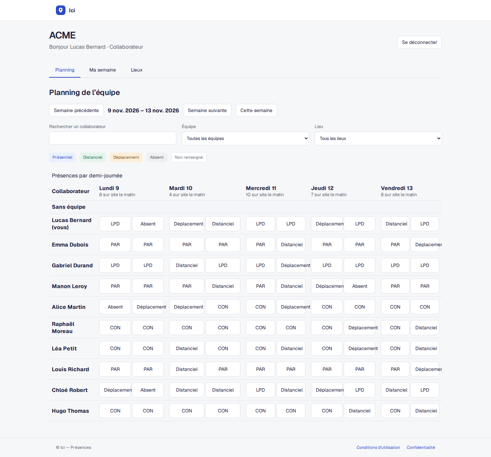
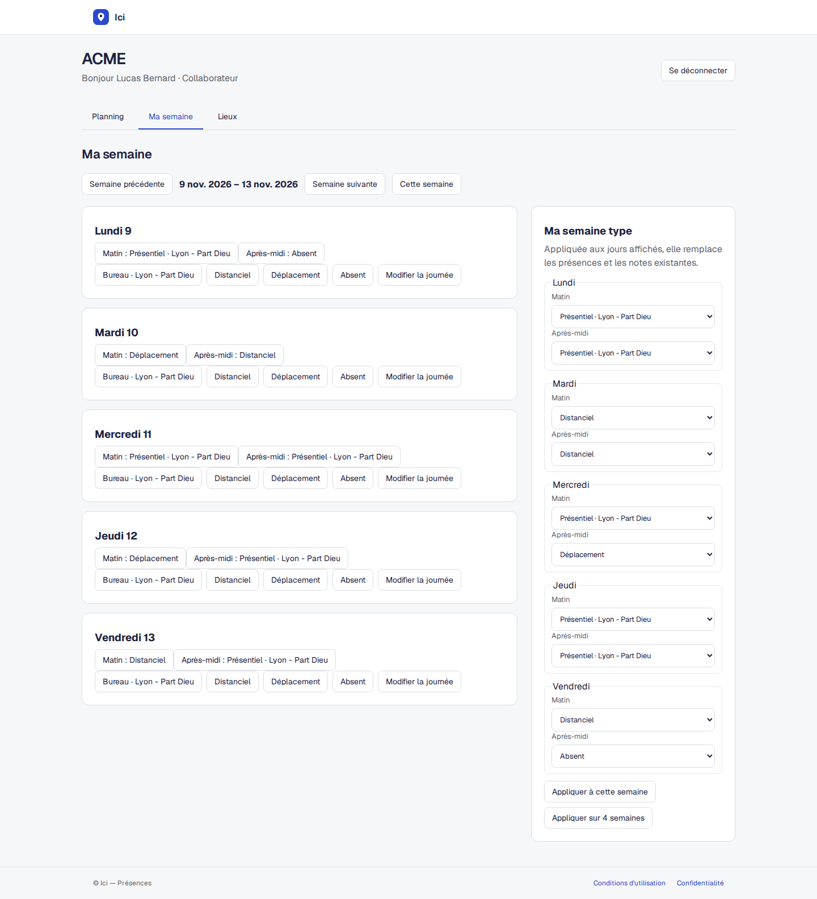
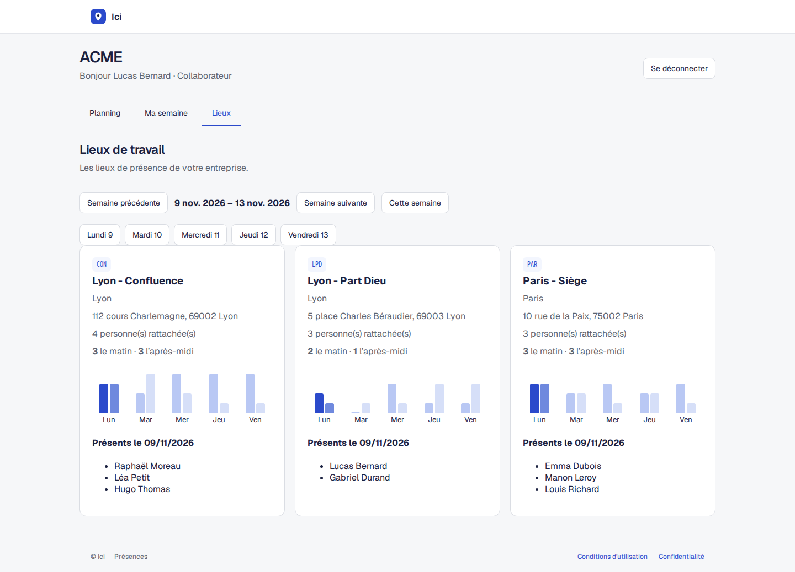

# ici

A team presence planning app for organizing office days, remote work, travel and time off. Teams share a weekly calendar, save personal templates and view location occupancy in an isolated workspace, with administration of users, teams and locations.

## Quickstart

```sh
make dev
```

Open http://ici.localhost:5173. Prerequisites, email activation and optional ACME demonstration accounts are described in [Getting started](docs/getting-started.md).

## Sign in with development fixtures

Load the demonstration data, then start the development stack:

```sh
make fixtures
make dev
```

Open http://acme.ici.localhost:5173 and sign in with one of these accounts:

| Role | Email | Password |
| --- | --- | --- |
| Administrator | admin@example.com | password |
| Collaborator | user@example.com | password |

If signing in from the public page, enter `acme` as the workspace. These accounts are already active; no email activation is required. The shared password is for development fixtures only.

Reloading fixtures replaces ACME data and invalidates its sessions while preserving other workspaces. See [Development fixtures](docs/getting-started.md#development-fixtures) for details.

## Documentation

- [Documentation index](docs/README.md) — getting started, development, operations and architecture decisions.
- [Contributing](CONTRIBUTING.md) — contribution workflow and required quality checks.

## Screenshots

Screenshots from the ACME demonstration workspace.

**Team planning**



**My week**



**Location occupancy**


